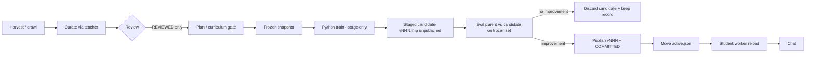

# Architecture

This article describes how SimpleMindsAI is put together: the two planes, the
responsibilities of each subsystem, how a piece of collected text becomes a
training example, how a chat turn is answered, and the invariants that hold the
design together. It is aimed at contributors and reviewers who need the system
model, not the first-time visitor.

- For the correctness argument that the student is genuinely trained from random
  initialisation, see [PROOF.md](PROOF.md).
- For the store layout, artifact naming and deployment procedure, see
  [DEPLOYMENT.md](DEPLOYMENT.md).
- For local setup, the repository map and how to run the tests, see
  [DEVELOPMENT.md](DEVELOPMENT.md).

## Contents

- [Two planes](#two-planes)
- [Node data plane components](#node-data-plane-components)
- [Python compute plane components](#python-compute-plane-components)
- [Data flow](#data-flow)
- [The training unit is an article, not a pair](#the-training-unit-is-an-article-not-a-pair)
- [The dataset store is a ledger, not a queue](#the-dataset-store-is-a-ledger-not-a-queue)
- [How documents become training examples](#how-documents-become-training-examples)
- [Review cadence](#review-cadence)
- [Chat, the student worker, and the loss gate](#chat-the-student-worker-and-the-loss-gate)
- [Admin portal (Learning Observatory)](#admin-portal-learning-observatory)
- [Model architecture](#model-architecture)
- [Invariants — do not break these](#invariants--do-not-break-these)
- [Key design decisions](#key-design-decisions)

---

## Two planes

SimpleMindsAI is deliberately split into two planes that share a store, not a
process:

- **Node data plane** (this repository's `src/`) — harvest, curate, review, plan,
  registry, provenance. It owns the corpus and the ledger. It never touches a GPU.
- **Python compute plane** (`python/`) — random initialisation, tokenization and
  packing, optimization, checkpointing, evaluation, generation. It owns the
  accelerator. It never writes the Node registry.

The teacher (DeepSeek, via Ollama) is a **researcher and reviewer only**. It is
never the brain, and it is never a fallback for the brain.

```
  SUBSYSTEM A (harvest & ingest)          SUBSYSTEM B (plan)
  ┌──────────────┐   ┌────────────────┐   ┌──────────────────────┐
  │ crawler.js   │──▶│ curator.js     │   │ planner.js           │
  │ raw blobs    │   │ deepseek-r1    │   │ reads measurements,  │
  │(placeholder) │   │ via Ollama     │   │ asks LLM for a       │
  └──────────────┘   │ → long-form    │   │ balanced curriculum  │
                     │   articles     │   └──────────┬───────────┘
                     └────────┬───────┘   (advisory: deterministic
                              │                   gate has final say)
  ┌───────────────────────────── buffer ◀──────────┘
  ── transient (purgeable) ──▐ Article ▐ ReviewVerdict ▐
  ── durable ────────────────▐ TrainingLog ▐ trained marks ▐
  └────────────────────────────▲───┬──────────────────────────┘
                               │   │ consumeBatch (REVIEWED only) + commitConsumption
  SUBSYSTEM C (train & chat)   │   ▼
  ┌──────────────┐  ┌────────────────────┐  ┌──────────────────────┐
  │ cli/train.js │─▶│ dataset/snapshot.js│─▶│ PYTHON COMPUTE PLANE  │
  │ orchestrator │  │ immutable records  │  │ sma.brain (one-shot) │
  └──────┬───────┘  └────────────────────┘  │ init/train/eval/diff │
         │                                  │ generate → JSON      │
         │                                  └──────────┬───────────┘
         ▼                                             │
  ┌────────────────────┐  ┌────────────────────┐       │ active.json
  │ loss-evaluator.js  │  │ python-promotion.js│       │ (committed vNNN)
  │ parent vs candidate│─▶│ loss gate → switch │       │
  │ same frozen set    │  └─────────┬──────────┘       ▼
  └────────────────────┘            │        ┌──────────────────────┐
                                    │        │ sma.student          │
  ┌──────────────┐  ┌────────────────┴───┐    │ long-lived worker    │
  │ chat-server  │─▶│ brain.js           │───▶│ framed stdio; keeps  │
  │ chat UI      │  │ the student (only) │    │ the active brain hot │
  └──────────────┘  └────────────────────┘    └──────────────────────┘
                     evaluation-set.js (frozen, leak-guarded)
                     registry-store.js (append-only ledger, RUN.lock)
```

There is **no teacher fallback**: `src/brain/brain.js` talks only to the Python
student worker, and if that worker is unavailable the chat route returns an
explicit `503` rather than asking DeepSeek to answer as the student.

---

## Node data plane components

The Node plane owns the corpus and the ledger. Its modules fall into the
following groups:

| Area | Modules | Responsibility |
|---|---|---|
| Harvest / ingest | `src/harness/crawler.js`, `src/harness/fetcher.js`, `src/services/curator.js` | Fetch configured sources only (`CRAWL_MODE=real` fetches the explicit `CRAWL_URLS`, bounded and robots-aware; there is no search-engine discovery mode) and turn raw text into long-form articles via the teacher. |
| Teacher client | `src/services/ollama-client.js` | Talks to Ollama. Teacher/critic only. |
| Domain | `src/domain/article.js`, `src/domain/review-policy.js` | Authoritative article lifecycle and importance, and the review-policy rules for autonomous selection and teacher/human transitions. |
| Storage | `src/storage/article-store.js`, `src/storage/registry-store.js` | The authoritative `Article` ledger, and the append-only registry (ledger + `RUN.lock`). A legacy pair-buffer is detect-only. |
| Dataset | `src/dataset/snapshot.js`, `src/dataset/evaluation-set.js` | Immutable, hash-sealed snapshots, and the frozen, leak-guarded evaluation set. |
| Training orchestration | `src/training/lifecycle.js`, `src/training/trainer-interface.js`, `src/training/evaluator.js`, `src/training/model-handle.js`, `src/training/loss-evaluator.js`, `src/training/python-promotion.js`, `src/training/python-trainer.js` | Lifecycle, the trainer selector (real Python CausalLM trainer by default; the stub is a legacy, explicitly opt-in path via `TRAINER_KIND=stub`), the legacy evaluator, and the authoritative causal-LM loss gate that drives promotion. |
| Brain / chat / reward | `src/brain/brain.js`, `src/brain/python-cli.js`, `src/brain/student-worker.js`, `src/chat/`, `src/reward/` | The Python CLI bridge, the student worker owner, the chat server, and the advisory reward scorer. |
| Curriculum | `src/curriculum/validation.js` | The deterministic gate every LLM-proposed curriculum must pass. |
| API / CLI | `src/graphql/`, `src/cli/` | GraphQL schema and resolvers, and the one-shot runners (`train`, `evaluate`, `promote`, `reject`, `perpetual`). |
| Admin | `src/admin/` | Portal REST/SSE routes, the change feed, governance services, a read-only Python-store reader, and the dependency-free SPA. |

The GraphQL surface is the only way subsystems talk to the ledger, which keeps
the transient/durable boundary explicit. The admin REST/SSE surface is the human
observability layer over the same validated Node services.

---

## Python compute plane components

The Python plane owns the accelerator. Its modules (`python/sma/`):

| Module | Responsibility |
|---|---|
| `configs.py` | The 3B architecture source of truth, the derived 62M config, and expected parameter counts. |
| `arch.py` | SmolLM3 construction, validation, and parameter accounting. |
| `proof.py` | Config-only fetch, AST audit for pretrained-weight loads, tensor hashes, and the loss-signature check. |
| `store.py` | Immutable versions, atomic commit, durability, heartbeat, content-addressed naming, export and verify. |
| `data.py` | Ingestion, content hashes, `concatenate-chunk-v1` packing, and the train/validation split. |
| `train.py` | The precision model, guards, instrumentation, and resumable train state. |
| `brain.py` | The CLI and the one-JSON-object subprocess contract (`init`, `status`, `corpus-info`, `train` (+`--stage-only`), `publish`, `discard`, `eval` (+`--staged`), `generate`, `diff`, `export`, `verify-export`, `active`). |
| `student.py` | The long-lived chat worker (framed stdio, hot active brain). |
| `preflight.py` | The read-only Phase 2 memory/portability budget that gates a long 3B run. |
| `portability.py` | Platform and backend detection, and the bf16 probe. |
| `fixtures/tiny_en.txt` | A deterministic corpus (original prose — no licensing question). |

The Python plane never writes the Node registry. It communicates results back
through its stdout contract (see
[the subprocess contract](DEVELOPMENT.md#the-subprocess-contract)).

---

## Data flow

The lifecycle is a single pipeline. The Node plane carries text through
harvest, curation, review and planning; the Python plane consumes a frozen
snapshot and produces an immutable checkpoint; the loss gate decides whether the
new checkpoint replaces the active one.



Key boundary rules:

- Only `REVIEWED` articles are trainable. Unreviewed text is buffered, not
  consumed.
- The trainer reads frozen records only; consumption is committed *after* the
  run records success, so a crash never double-trains.
- The LLM plan is advisory; the deterministic `validateCurriculum` gate has the
  final say.
- A committed version is immutable and append-only. `active.json` is the only
  mutable pointer, and it is a deployment concept, never part of a manifest.

---

## Three states of a brain: run, staged candidate, published version

The lifecycle deliberately separates three things that earlier shared one name,
because conflating them is exactly how a rejected candidate leaked into the
version lineage as a new `vNNN`:

| State | On disk | Visible as a version? | Mutable? |
| --- | --- | --- | --- |
| **Training run** | Node `TrainingRun` record + frozen snapshot + `_runs/vNNN.train-state.pt` | no | a run is a process, not an artifact |
| **Staged candidate** | `SMA_STORE/vNNN.tmp/` (full checkpoint, **no** `COMMITTED`) | no — `list_versions` skips it | yes; deleted on rejection |
| **Published version** | `SMA_STORE/vNNN/` + `COMMITTED` | yes | no — immutable and append-only |

**Commit-on-promotion.** A real (Python) training run builds its checkpoint with
`--stage-only`, which writes an *unpublished* `vNNN.tmp` and nothing else. The
candidate is then scored on the frozen eval set via `eval --staged`, which reads
the `.tmp` directory in place. Only if the loss gate promotes it does the
lifecycle run `brain publish`, which (`os.replace` + `COMMITTED`) turns the
candidate into an immutable `vNNN`. A rejected candidate is removed with
`brain discard --keep-record <dir>`, which drops the weights but copies the small
provenance record (manifest, train-state, provenance, parameter diff) so a
rejection is still auditable. **A rejected candidate never appears in the
published version list and never becomes active.**

**Why the version number is not re-allocated.** Node serialises real runs behind
`RUN.lock`, and `store.next_version` skips `.tmp` names, so a staged candidate’s
number is stable from staging to publication. `stage_dir` clears any stale
`vNNN.tmp` before it starts, so a crash never leaves a candidate that a later run
would publish under the wrong lineage.

**Crash-safety and idempotence.** The commit tail runs in a fixed order —
**publication → active-pointer update → manifest completion → consumption
commit** — and every step is durable and idempotent: `publish` on an
already-committed version is a no-op, activating the same version is a no-op, and
`markConsumed` skips what is already consumed. The exactly-once consumption
commit runs **last**, so a crash between any two steps is recovered in-process
from the run manifest (`decision`, `status`, `consumed`) by retrying the next
step — never by re-running training, never by guessing. A rejected candidate is
never published; a promoted-but-not-yet-consumed run is re-published,
re-activated, and re-consumed without duplicating either the version or the
consumption. The `.tmp` directory a killed process leaves behind is invisible to
every consumer and re-swept (`store.sweep_stale_staging`) or overwritten by the
next `stage_dir`.

Older stores legitimately contain versions that predate this rule; they are left
untouched. The rule governs only how *new* candidates become versions.

---

## The training unit is an article, not a pair

The earlier design trained on `{prompt, completion}` pairs scored by a critic.
That is instruction-tuning, and it is not what this project does. The student is
a **raw causal language model**: it learns by predicting the next token in
continuous text. Consequences:

- **No reward in the training signal.** `RewardScore`, `MAX_SYNTHETIC_SHARE`,
  and the echo-chamber cap guard an SFT failure mode that this design does not
  have. Keep the deterministic guardrail for chat quality, but it must never
  select training data.
- **The critic is advisory.** A reward model may flag bad articles. It may not
  be the gate.
- **Only `REVIEWED` articles are trainable.** Unreviewed text is buffered but not
  consumed.

---

## The dataset store is a ledger, not a queue

Consumed training material is **not** discarded after training. Articles are
marked consumed so they are not trained on twice, but they remain addressable
and their content hashes are retained. This is a storage design constraint, not
a replay feature: it keeps the [replay option](ROADMAP.md#1-catastrophic-forgetting)
open without implementing any part of it, and it is cheap now and impossible to
retrofit later.

---

## How documents become training examples

`concatenate-chunk-v1`, in `python/sma/data.py`:

```
tokenize each document -> concatenate with a "\n\n" separator -> chunk into
fixed-length blocks -> each block is one example, labels shifted by the model
```

No padding, no attention masking, no per-block document bookkeeping. A block may
straddle a document boundary. That is a deliberate trade: it maximises token
efficiency and makes the token stream trivially reconstructible from the recorded
parameters, which is the binding constraint for future replay. The alternative —
per-document with EOS separators and masking — changes what the loss number
*means*, so the two are never mixed silently.

Every consumed article is recorded by **both** `articleId` and `contentHash`, and
`pack()` verifies the hash against the text rather than trusting the caller — a
stale hash would make the contribution record quietly false, and that failure
would surface months later during a replay, when it is expensive to diagnose.

The train/validation split holds out a **contiguous tail** of whole blocks, never
a random subset. A random split over a packed stream leaks neighbouring context
across the boundary, which makes a validation number optimistic for a reason that
has nothing to do with the model.

---

## Review cadence

Review runs every **1,000** consumed articles (`REVIEW_INTERVAL`, default 1000).
This is an **interval, not a cap**. It does not stop training, reset the brain,
or create a fresh dataset. The lineage is append-only and continuous, and the
model trains continuously for years across millions of articles.

Teacher review is **sampled** — proposed default 5–10% of articles
(`REVIEW_SAMPLE_RATE`). The primary mission remains human-controlled; sampling is
a throughput measure, not a transfer of authority.

---

## Chat, the student worker, and the loss gate

### One resident student, no teacher in the loop

`python -m sma.student` is a **long-lived** process, separate from the one-shot
`sma.brain` CLI. It keeps the active brain loaded between chat turns and speaks a
framed protocol:

```
stdin   one JSON request per line   {"id": n, "op": "load|generate|reload|version|ping|shutdown", ...}
stdout  exactly one JSON response per line, echoing `id`
stderr  logs only, never parsed
```

Node's `StudentWorker` (`src/brain/student-worker.js`) owns the child's
lifecycle: one in-flight request at a time matched by id, per-request timeouts,
crash detection that rejects every pending request and restarts with backoff, and
a clean shutdown. `src/brain/brain.js` talks **only** to this worker. If it is not
running, `respond()` throws and the chat route returns `503` — it never asks the
teacher to impersonate the student. A regression test reads `brain.js` and fails
if the words Ollama/DeepSeek reappear in its code.

Version safety falls out of the existing store rules: the worker loads through
`store.resolve_version_dir`, which **refuses any version without a `COMMITTED`
marker**, so a partially written checkpoint can never be served. A version switch
is a two-step, fail-safe move: fully load the new checkpoint into a local, then
swap it over the resident model — a failed load leaves the previous brain
serving.

### The promotion gate is causal-LM loss, not token-F1

Token-F1 over short completions was never a brain-quality signal, and its zero
default could promote a model that had not improved. The authoritative gate for
the real brain now scores **parent and candidate with the same Python code on the
same frozen evaluation set** (`sma.brain eval --eval-set … --verify-weights`), and
promotes only when:

- both losses are present and finite,
- both were measured on the **same** `datasetHash` (comparable),
- `parentLoss − candidateLoss >= PROMOTE_MIN_LOSS_DELTA`, and
- `candidateLoss <= PROMOTE_MAX_LOSS`.

Missing, invalid, non-finite, or incomparable results produce `not_evaluated` —
never a promotion. On `promoted` the active pointer (`$SMA_STORE/active.json`)
moves to the candidate and the resident worker is reloaded so the **next** chat
turn is answered by the new brain; on `rejected` or `not_evaluated` the pointer
does not move. Token-F1 remains available as a **supplementary** indicator only.

Measured on the frozen `data/evaluation/eval-001.jsonl` (science Q/A), CPU,
`--seq-len 32 --micro-batch 2 --verify-weights` (see
[How checks 8 and 9 are measured](PROOF.md#how-checks-8-and-9-are-measured)):

| version | trained steps | eval loss | datasetHash | note |
|---|---|---|---|---|
| `v001` | 0 | 11.9452 | `d4677e09…` | within the init band; `lossSignature.applies` |
| `v002` | 60 | 11.5915 | `d4677e09…` | improvement 0.3537 → promotable; band no longer applies |

Both report the identical `datasetHash`
(`d4677e09878a155c0bd4cab61baf807ba6413a7f2172fa91e9f1463979344374`), which is
what makes the pair comparable, and both pass `--verify-weights`
(`verifiedAll: true`) — the evaluation hashes the loaded tensors against the
manifest and runs under `torch.no_grad()`, so it cannot move a weight. These
frozen-set numbers are distinct from the fixture training-curve losses
(11.83 → 7.72 train, 11.82 → 11.54 validation); only the frozen comparison is a
promotion signal.

Regression tests drive the real store copy: a **worse** candidate (`v001` over
`v002`) is rejected and the active pointer is unchanged; a **better** candidate
(`v002` over `v001`) is promoted, the pointer moves, and the running worker serves
`v002` on the next request; an **unevaluable** candidate is `not_evaluated` and
changes nothing.

---

## Admin portal (Learning Observatory)

`npm start` boots **one** server: GraphQL at `/graphql` and the admin portal at
`http://localhost:4000/admin`. The portal is a dependency-free (vanilla JS) SPA
over the same validated Node services — it reads the article ledger, the
registry, the governance store, and the read-only Python `SMA_STORE`, and mutates
only through those services. It binds `127.0.0.1` by default; `API_HOST=0.0.0.0`
exposes it deliberately.

| Section | What it shows |
|---|---|
| Dashboard | ledger + registry + Python store at a glance, plus live connection state |
| Articles | every article and its state, per-article review history, importance, and request-review / set-importance actions |
| Learning & Training | teacher readiness, training eligibility, start/stop for learning and training (bounded/continuous, explicit training parent), fresh-brain creation, and durable job history + log |
| Review Cycles | open checkpoint cycles (every 1,000 consumed articles — an interval, not a cap) |
| Live Chat | the real active student worker, with the student version and generation status; it never falls back to the teacher |
| Mission & Strategy | primary/secondary mission and collection strategy with `propose → review → approve/reject → apply`; AI may propose secondary-mission and strategy changes only |
| Training History | **both** sources — the Node registry (orchestration/audit) and the read-only Python `SMA_STORE` (committed versions, `active.json`, provenance, metrics); unavailable metrics are reported as unavailable, never as zero |
| Trends & Metrics | deterministic trend classification (improving / worsening / plateauing / potentially-overfitting / insufficient evidence) over recorded, comparable losses. The classifier in `src/admin/metrics.js` is a pure function — no I/O, no randomness — fed from train-state files and frozen eval-set records; validation and training losses are only ever compared within the same dataset hash. |

REST surface (all under `/api/admin`): `overview`, `metrics`, `articles` (+`/:id`),
`articles/select-for-review`, `articles/:id/request-review`,
`articles/:id/importance`, `articles/:id/status`, `articles/:id/review`,
`review-cycles` (+`/ensure`, `/:id/close`), `mission` (+`/secondary`, `/primary`,
`/proposals`, `/proposals/:id/approve|reject`), `strategy` (+`/proposals/...`),
`training-history`, `python-store`, `chat` (+`/chat/identity`). The mission and
strategy stores are append-only: every change is a new version recording origin,
actor, rationale and the proposal/review-cycle it came from.

**Managed lifecycle jobs.** Long-running work (learning, training, fresh-brain)
is owned by a single `JobSupervisor` (`src/jobs/`) bound to the one live writable
`development` store; inspection workspaces can read job history but never start
or stop work. Jobs are durable: creation, status transitions, progress and output
are appended to `jobs.ndjson` / `job-events.ndjson` / `job-log.ndjson`, so history
survives a restart. Cancellation is cooperative-first — an abort signal is raised,
`runJsonProcess` kills the spawned process tree after a bounded grace period, and
`killProcessTree` (`src/jobs/process.js`) is the Windows/Ubuntu last resort.
Nothing auto-resumes on boot: `reconcile()` folds each non-terminal job against
the real lifecycle/registry/checkpoint/promotion state and reports `interrupted`
(or `completed` if promotion genuinely committed before the crash). Training
resolves an explicit `parentVersion` fail-closed via the python-trainer
(`resolvePythonVersion`), and fresh brains are registered unpromoted — the
learner never activates itself. Related endpoints: `jobs` (+`/:id`, `/:id/log`,
`/:id/stop`), `learning/start|stop`, `training/start|stop`, `training/eligibility`,
`brain/fresh`, `teacher`, `brain/versions`.

The header **model-version selector** loads committed versions dynamically from
the selected workspace's `readPythonStore` and pins the scope for Dashboard, Chat
view, Training History and Trends (`?version=` on `metrics`). It is deliberately
separate from the active pointer and from a job's training parent: pinning only
changes which version's history/metrics are inspected, never serving or training
targets.

Live updates use Server-Sent Events at `/api/admin/events`: a `hello` frame
carrying the current sequence, then `change` frames (plus a `resync` frame if the
client's `since` cursor has fallen outside the replay window). A client that
detects a sequence gap re-fetches authoritative state, so a missed event degrades
to a refresh — never to stale data. Every section renders explicit **loading /
empty / unavailable / error / disconnected** states, because an empty `data/`
tree and a missing `SMA_STORE` are normal first-run conditions, not failures.

---

## Model architecture

`SmolLM3ForCausalLM`, built from a config. Same code path for both sizes — only
scale fields differ.

| | `small` (dev/CI) | `3b` (target) |
|---|---|---|
| layers | 8 | 36 |
| hidden | 384 | 2048 |
| attention heads | 6 | 16 |
| KV heads | 2 | 4 |
| head dim (derived) | 64 | 128 |
| intermediate | 1024 | 11008 |
| max positions | 2048 | 65536 |
| **unique params** | **61,839,744** | **3,075,098,624** |

Shared by both, and asserted field by field: vocab 128256, tied embeddings,
`rope_theta` 5000000.0, RMSNorm eps 1e-6, no attention or MLP bias,
`hidden_act: silu`, `no_rope_layer_interval: 4` (NoPE on every 4th layer:
`small` → layers 3 and 7), attention dropout 0, `sliding_window: null`, no rope
scaling.

`small` is **derived** from the 3B config by overriding only `SCALE_FIELDS`; a
test fails if any non-scale field is touched, so the two can never silently drift
apart.

Source of truth:
`https://huggingface.co/HuggingFaceTB/SmolLM3-3B-Base/raw/main/config.json`.

### Do not construct SmolLM3 from class defaults

`SmolLM3Config()` defaults differ from the published SmolLM3 config:
`max_position_embeddings` is 32768 (not 65536), `rope_theta` is 2000000.0 (not
5000000.0), and `bos_token_id` is 128000 (not `null`). Building from defaults
instead of from the published file trains different RoPE with a spurious BOS
token, and **nothing raises**. `test_class_defaults_differ_from_published_config`
pins this so a future transformers upgrade that aligns the defaults is noticed.

---

## Invariants — do not break these

1. **Never load pretrained weights into the student.** Config, tokenizer, and
   teacher text only. Enforced by check 4; see [Proof obligations](PROOF.md#proof-obligations).
2. **Never train on the live buffer.** The trainer reads frozen records only;
   consumption is committed *after* the run records success, so a crash never
   double-trains.
3. **Never consume unreviewed articles.** Only `REVIEWED` is trainable.
4. **The LLM plan is advisory.** Any curriculum must survive `validateCurriculum`;
   on failure the run proceeds with `fallbackCurriculum`. A malformed plan cannot
   stall the loop.
5. **The eval set never leaks.** Sets are frozen and hash-sealed at run start; the
   pair-hash guard refuses rows appearing in both.
6. **Never promote without an evaluation.** Enforced by the causal-LM loss gate
   (`src/training/loss-evaluator.js` + `src/training/python-promotion.js`); an
   unevaluable candidate is `not_evaluated`, never promoted.
7. **A rejected candidate never becomes a version.** Training stages an
   unpublished `vNNN.tmp`; only a promoted candidate is published into an
   immutable `vNNN`. See *Three states of a brain*.
8. **Checkpoints are immutable and append-only.** `vNNN` directories are never
   rewritten.
9. **Every checkpoint carries provenance.** Seed, initializer, config source,
   tensor hashes, and the structural audit result.
10. **A failed or corrupted run never replaces the active brain.** Numerical
    failure, a lost process, or a crash mid-run must leave the previous brain
    serving. Detection, logging, and safe checkpoint-or-fail are Phase 1
    requirements.
11. **Consumed training material stays reconstructable.** Article content hashes,
    packing parameters, and the per-version contribution record are retained so
    historical training sets can be rebuilt for replay later. Replay itself is a
    later experiment; losing the ability to reconstruct history is not
    recoverable.
12. **Master weights are fp32, always.** Compute may be bf16; the dtype the
    optimizer updates may not be. With bf16 masters, 17 of 74 parameters receive
    gradients and then round away to unchanged — silently, with a falling loss
    curve and no error. See
    [bf16 master weights silently freeze 17 parameters](FINDINGS.md#bf16-master-weights-silently-freeze-17-parameters).
13. **There is no default learning rate.** `--lr` is required and `TrainConfig`
    has no default. The right value depends on optimizer, batch size, sequence
    length, model size, schedule and warm-up; a constant in the code would be a
    number that looks measured and is not. A test fails if one is reintroduced.
14. **A resume must not cross a changed corpus or config.** Resume verifies
    `datasetHash` and every config field except `steps`, and refuses if the step
    target does not advance. Silently continuing against different data would make
    the recorded attribution a lie.

---

## Key design decisions

- **A single invariant outranks everything else:** the student is randomly
  initialised and never receives pretrained neural weights. See
  [PROOF.md](PROOF.md).
- **The training unit is a continuous token stream, not scored pairs.** The
  reward signal is therefore not part of the loss.
- **The dataset store is a ledger.** Nothing consumed is discarded, so replay
  stays possible without being implemented.
- **The packed-token stream is the reconstructable artifact.** Content hashes,
  packing parameters and tokenizer identity are recorded so a historical dataset
  can be rebuilt byte-for-byte.
- **There is no teacher fallback.** A chat turn comes from the student or not at
  all.
- **Promotion is decided by causal-LM loss on a frozen set**, fail-closed.
- **Master weights are fp32 and `--lr` has no default**, so training state is
  always interpretable and attributable.
- **Weights live outside git history, hashed by a manifest.** See
  [DEPLOYMENT.md](DEPLOYMENT.md).
